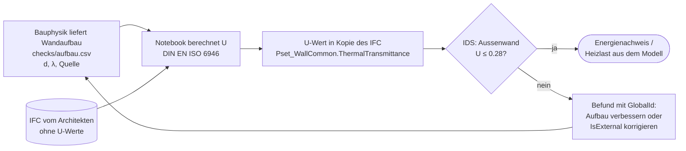

# Prozess

Unser Prozessmodell IST/SOLL (Abgabe 19.10.):
[`Team_2_U-Wert_Prozess_Ist_Soll.drawio.pdf`](Team_2_U-Wert_Prozess_Ist_Soll.drawio.pdf)

## Wo unser MVP im SOLL-Prozess vorkommt

1. Der Auftraggeber stellt die IDS bereit → `requirements/Team2_U-Wert.ids`
2. Der Architekt erfasst die U-Werte im Modell und lädt das IFC auf die CDE.
3. **Das Informationsmanagement prüft das IFC mit der IDS in IFC-Lite.
   Das ist unser MVP.**
4. Nicht bestanden: Befund (BCF) an den Architekten, er korrigiert und
   liefert neu. Die Regel bleibt gleich.
5. Bestanden: Die Bauphysik erstellt den Energienachweis aus dem Modell,
   der Auftraggeber gibt die Lieferung frei.

## MVP v0.2: der Soll-Prozess mit Berechnung

1. Die **Bauphysik** liefert den Wandaufbau pro Wandtyp (`checks/aufbau.csv`), jede Zahl mit Quelle.
2. Das **Notebook** findet die Aussenwände, berechnet U und schreibt ihn in eine Kopie des Modells.
3. Das **Informationsmanagement** prüft die Kopie mit der IDS (Notebook oder IFC-Lite).
4. Nicht bestanden: Befund an Bauphysik (Aufbau) oder Architekt (`IsExternal`, Modellierung). Die Regel bleibt gleich.
5. Bestanden: Energienachweis und Heizlast (DIN EN 12831) aus dem Modell.
